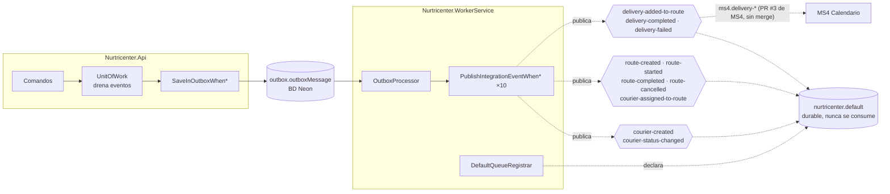

# Mensajería — MS5

## Eventos publicados
MS5 publica **10 contratos de integración**, uno por cada hecho de su dominio, con **outbox transaccional**. Los contratos viven en el kernel `Nur.Tricenter.Integration` 1.1.0 (namespace `Nur.Tricenter.Integration.Messages.Logistics`) y los nombres de exchange en `contracts/NurtricenterExchanges.cs` del repo. Todos los exchanges son `fanout`, no durables, no auto-delete, y coinciden con `nur-tricenter-local/topology/rabbitmq-definitions.json`.

| Exchange | Contrato (kernel) | EventType | Se dispara cuando | Outbox |
|---|---|---|---|---|
| `courier-created` | `CourierCreated` | `Courier.Created` | Se crea un repartidor (`POST /couriers`) | sí |
| `courier-status-changed` | `CourierStatusChanged` | `Courier.StatusChanged` | `Courier.SetStatus` con un estado distinto. **Ningún caso de uso lo llama hoy** | sí (cableado, inalcanzable) |
| `route-created` | `RouteCreated` | `Route.Created` | Se crea una ruta (`POST /routes`) | sí |
| `courier-assigned-to-route` | `CourierAssignedToRoute` | `Route.CourierAssigned` | `Route.AssignCourier`. **Sin endpoint** | sí (cableado, inalcanzable) |
| `delivery-added-to-route` | `DeliveryAddedToRoute` | `Route.DeliveryAdded` | Se agrega un paquete a la ruta de hoy (`POST /packages/deliveries`, uno por ítem) | sí |
| `route-started` | `RouteStarted` | `Route.Started` | El repartidor inicia la ruta (`POST /routes/{id}/start`) | sí |
| `route-completed` | `RouteCompleted` | `Route.Completed` | La última entrega abierta de una ruta `InProgress` pasa a terminal (automático) | sí |
| `route-cancelled` | `RouteCancelled` | `Route.Cancelled` | `Route.CancelRoute`. **Sin endpoint** | sí (cableado, inalcanzable) |
| `delivery-completed` | `DeliveryCompleted` | `Delivery.Completed` | Entrega exitosa (`POST …/deliver`) | sí |
| `delivery-failed` | `DeliveryFailed` | `Delivery.Failed` | Entrega fallida (`POST …/fail`); también por cada entrega abierta al cancelar una ruta | sí |

Payload de cada contrato (además del sobre común `Id`, `CreatedAt`, `CorrelationId`, `Source`):
- `CourierCreated`: `CourierId, FullName, Status` (`Status` como texto: `"Available"`).
- `CourierStatusChanged`: `CourierId, OldStatus, NewStatus` (texto).
- `RouteCreated`: `RouteId, CourierId, ScheduledDate` (`DateOnly`, `yyyy-MM-dd`).
- `CourierAssignedToRoute`: `RouteId, CourierId`.
- `DeliveryAddedToRoute`: `RouteId, DeliveryId, PackageId, PatientId` (los dos últimos, texto).
- `RouteStarted`, `RouteCompleted`, `RouteCancelled`: `RouteId`.
- `DeliveryCompleted`: `DeliveryId, RouteId, DeliveredAt` (UTC). **No trae evidencia (foto, firma) ni `PackageId` ni `PatientId`.**
- `DeliveryFailed`: `DeliveryId, RouteId, Reason`. **Tampoco trae `PackageId` ni `PatientId`.**
- `Source` siempre es `"nurtricenter"`.

### ¿Qué le puede interesar a otro servicio?
- **MS4** consume `delivery-added-to-route`, `delivery-completed` y `delivery-failed` para cerrar sus `DeliveryDay` (colas `ms4.delivery-*`, topología mergeada en nur-tricenter-local#6; código en el PR Nur-tricenter/ms4-delivery-schedule-management#3, **pendiente de merge**). Como `delivery-completed`/`delivery-failed` solo traen ids de MS5, MS4 guarda el vínculo `DeliveryId` → día al recibir `delivery-added-to-route`, interpretando su `PackageId` como su `packId` (`DeliveryDay.Id`, entero). Si el `PackageId` cargado en MS5 no es ese `packId`, MS4 no vincula la entrega y el día no se cierra (ms5-gap-02). La evidencia (foto, firma) no viaja.
- **MS3** podría usar `route-completed` para saber que se terminó el reparto del día. Nadie lo consume.

## Cadena del outbox
```
POST /…  → handler de comando → aggregate.AddDomainEvent(...)
         → UnitOfWork.CommitAsync()
              1. drena los eventos de dominio de todas las entidades rastreadas (hasta 10 rondas)
              2. mediator.Publish(evento) en proceso:
                   - SaveInOutboxWhen*Event       → OutboxMessage<DomainEvent> en el MISMO DbContext
                   - CompleteRouteWhenAllDeliveriesCompletedHandler (solo Delivery*) → puede cerrar la ruta
              3. SaveChangesAsync()  → agregado + filas outbox.outboxMessage, UNA transacción
Nurtricenter.WorkerService:
   OutboxProcessor<DomainEvent> (Joseco) lee filas Processed = false
     → re-envuelve cada fila como OutboxMessage<{tipo concreto}>
     → PublishIntegrationEventWhen*  (mapea evento de dominio → contrato del kernel)
     → IExternalPublisher.PublishAsync(contrato, exchange, declareDestination: true)
     → marca la fila como procesada
```
- Las rondas del drenaje existen porque cerrar la última entrega dispara `CompleteRoute`, que emite `RouteCompletedEvent`: se recoge en la ronda siguiente y entra en la misma transacción.
- Los handlers `PublishIntegrationEventWhen*` se registran **solo en el worker** (`AddIntegrationMessaging`); `AddApplication` los quita a propósito para que la API no necesite RabbitMQ.
- Cada publish handler implementa `INotificationHandler<OutboxMessage<XxxEvent>>` con el tipo **concreto**: Joseco despacha así, y un handler para `OutboxMessage<DomainEvent>` nunca se ejecutaría mientras la fila igual queda marcada como procesada (lo cubre `OutboxProcessorDispatchTests`).
- Los eventos de dominio tienen **un único constructor con parámetros**: con un constructor público sin parámetros, Newtonsoft construiría el evento vacío al leer el outbox (lo cubre `DomainEventOutboxSerializationTests`).
- `OutboxChainCoverageTests` y `NurtricenterExchangesTests` fallan si un evento de dominio no tiene su `SaveInOutbox`/`PublishIntegrationEvent`, o si un exchange no tiene publisher (o al revés).

## Eventos consumidos
**Ninguno en `main`.** El worker es "PURE PRODUCER" (`src/Nurtricenter.WorkerService/RabbitMqExtensions.cs`): `Program.cs` registra el publisher, el `OutboxProcessor` y `DefaultQueueRegistrar`, pero ningún `AddRabbitMqConsumer`. No hay inbox. Los paquetes entran solo por `POST /packages/deliveries`.

**Implementado en la rama `dev`, sin merge a `main`** (ms5-gap-03): `PackageValidatedConsumer` sobre la cola `ms5.package-validated` (contrato `PackageValidated` de `Messages.Contracting`, kernel 1.2.0), registrado con `RabbitMqExtensions.AddNurtricenterConsumers`. En `dev`:
- **Pipeline:** `TracingConsumer → IdempotentConsumer → PackageValidatedConsumer` (patrón de MS4), con inbox atómico en la tabla `InboxMessages` (migración `AddInboxMessages`), guardado en el mismo commit que la entrega y su fila de outbox.
- **Efecto:** `AddValidatedPackageCommand` agrega el paquete como `Delivery` `Pending` a la ruta de hoy más reciente; sin `Latitude`/`Longitude` usa `branchCoordinates`; **no** consulta ClinicService.
- **Errores:** sin ruta para hoy (o ruta cerrada) → reintentos y luego cola de error.

Cuando se mergee, esta sección y `service.yaml → events_consumed` deben actualizarse.

## Colas declaradas que no se consumen
La topología de `nur-tricenter-local` crea para MS5: `ms5.food-published`, `ms5.food-nutritional-info-updated`, `ms5.recipe-published`, `ms5.recipe-updated`, `ms5.meal-plan-published`, `ms5.user-published`, `ms5.user-updated` y `ms5.package-validated`. **En `main` MS5 no consume ninguna**: las siete primeras no le sirven (su dominio no usa alimentos, recetas, planes ni usuarios) y la octava solo la lee el consumidor de `dev`. Se acumulan mensajes sin leer (gap transversal X-06).

### Cola propia: `nurtricenter.default` (sink de historial)
`DefaultQueueRegistrar` (worker) declara al arrancar la cola **durable** `nurtricenter.default` y la enlaza a los 10 exchanges. **Nunca se consume a propósito**: su profundidad es la cantidad de eventos publicados y su contenido es el historial completo (equivalente a `catalog.default` de MS2). No está en `rabbitmq-definitions.json` ni en `contracts/events.yaml`, porque no es una cola de consumidor (no sigue `{consumidor}.{exchange}`).

Consecuencia: los eventos de MS5 **no se pierden** cuando el worker corre (quedan en el sink). De los 10 exchanges, solo los tres `delivery-*` tienen además una cola de consumidor (`ms4.delivery-added-to-route`, `ms4.delivery-completed`, `ms4.delivery-failed`); a los eventos de repartidores y rutas no reacciona ningún servicio (X-02).

## Garantías de entrega
- **Publicación:** outbox transaccional (`Joseco.Outbox.EFCore` 1.1.0, tabla `outbox.outboxMessage` en la BD Neon de MS5) + worker separado. Garantía **at-least-once**: si el publish falla, la fila queda sin procesar y se reintenta en la siguiente pasada. Un consumidor futuro tiene que ser idempotente por `Id`.
- **Registro manual del outbox:** `AddOutbox<T>()` de Joseco está compilado contra MediatR 12 y falla con MediatR 14, así que los servicios se registran a mano (`AddOutboxServices` en Infrastructure) con un `EfCoreOutboxService` propio.
- **Consumo:** no aplica en `main` (no hay consumidores ni inbox). El inbox `InboxMessages` existe solo en la rama `dev`.
- **Reintentos:** los del `OutboxProcessor` (cada pasada reintenta lo pendiente). `DefaultQueueRegistrar` reintenta la declaración cada 10 s si el broker no está. `RabbitMqSettings__MaxRetryAttempts` no se usa: es para consumidores.
- **Trazabilidad:** `OutboxTracingService` (decorador de `IOutboxService`) copia `Activity.Current.TraceId` a la fila como `TraceId` y `CorrelationId`. El `OutboxProcessor` descarta el `CorrelationId` al re-envolver, así que `OutboxCorrelation.Resolve` lo recupera del `Activity` `Joseco.Outbox` (el worker registra un `ActivityListener` para esa fuente). El `CorrelationId` del contrato publicado es ese trace id. **No hay exportador OpenTelemetry** ni kernel `Nur.Tricenter.Observability`: la traza se ve en los logs de Serilog (el worker enriquece con el span), no en Jaeger.
- **Topología:** MS5 declara sus 10 exchanges (con los mismos flags que la topología, si no RabbitMQ responde `406 PRECONDITION_FAILED`) y su sink. No declara colas de otros. El publisher usa `declareDestination: true`.
- **Puerto:** `Joseco.Communication.External.RabbitMQ` 1.1.0 ignora `RabbitMqSettings:Port`; el broker tiene que estar en 5672.

## Diagrama

