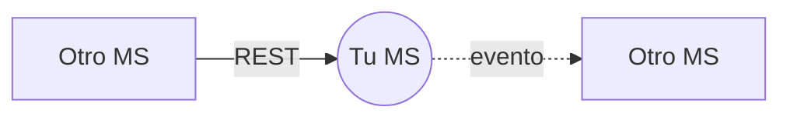

<!--
PLANTILLA — README del servicio (la puerta de entrada a tu MS).
Objetivo: que alguien que nunca vio tu repo entienda en 3 minutos qué hace tu servicio y con quién habla.
Borra todos los comentarios HTML cuando termines. Ejemplo: services/ms4-delivery-calendar/README.md
-->

# MSN — Nombre del servicio

> **Owner:** Nombre Apellido (@usuario) · **Repo:** [Nur-tricenter/repo](https://github.com/Nur-tricenter/repo) · **Estado de la ficha:** draft

## Propósito
<!-- 2–4 frases. ¿Qué problema de NEGOCIO resuelve? ¿Para quién? Evita hablar de tecnología aquí. -->

## Responsabilidades
<!-- Lista corta de lo que este servicio es DUEÑO (los datos y las decisiones que nadie más toma). -->
-

## Lo que NO hace
<!-- Igual de importante: qué cosas parecen suyas pero viven en otro MS. Indica en cuál. -->
-

## Actores y vecinos
<!-- Quién le habla y a quién le habla. Una fila por relación. -->
| Actor / servicio | Dirección | Mecanismo | Para qué |
|---|---|---|---|
| | entrante / saliente | REST vía gateway / evento RabbitMQ | |

## Mapa de comunicación
<!-- Diagrama Mermaid con tu servicio al centro. Usa flechas continuas para REST y punteadas para eventos. -->

## Stack y despliegue
<!-- Lenguaje/framework, BD, nombre en Consul, prefijo en el gateway, workers. -->

## Índice de la ficha
- [domain.md](./domain.md): modelo de dominio, estados e invariantes
- [api.md](./api.md): endpoints expuestos
- [integrations.md](./integrations.md): llamadas síncronas salientes
- [messaging.md](./messaging.md): eventos publicados y consumidos
- [flows.md](./flows.md): casos de uso de punta a punta
- [gaps.md](./gaps.md): deuda, inconsistencias y dependencias
- [service.yaml](./service.yaml): datos estructurados (los usa la app visual)
