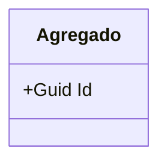
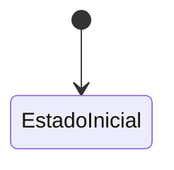

<!--
PLANTILLA — Modelo de dominio.
Preguntas guía:
  - ¿Cuáles son tus agregados (raíces) y qué invariante protege cada uno?
  - ¿Qué entidades y value objects viven dentro de cada agregado?
  - ¿Qué estados tiene la entidad principal y qué acción provoca cada transición?
  - ¿Qué reglas de negocio NUNCA se pueden romper? ¿Dónde se aplican en el código?
Regla: el código manda. Si la doc vieja dice otra cosa, escribe lo que hace el código y anota la diferencia en gaps.md.
-->

# Modelo de dominio — MSN

## Lenguaje ubicuo
<!-- Términos propios del servicio y qué significan EN ESTE contexto (si un término existe en otro MS con otro significado, acláralo). -->
| Término | Significado aquí |
|---|---|
| | |

## Agregados
### NombreDelAgregado (raíz)
- **Representa:**
- **Invariantes:**
- **Entidades internas:**
- **Value objects:**
- **Archivo:** `src/...`

## Diagrama de clases

## Máquina de estados
<!-- Si tu entidad principal tiene estados, dibújalos. Indica qué método/endpoint/evento dispara cada transición. -->

## Reglas de negocio
| Regla | Dónde se aplica (archivo/método) | Error si se viola |
|---|---|---|
| | | |

## Datos que son copia de otro servicio
<!-- Proyecciones/read models alimentados por eventos o llamadas: qué datos, de qué MS, cómo se mantienen frescos. -->
