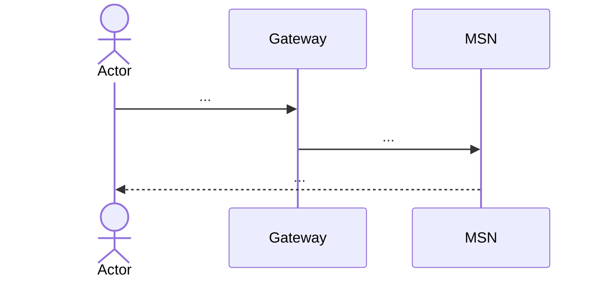

<!--
PLANTILLA — Flujos de punta a punta.
Elige los 3–6 casos de uso más importantes de tu servicio, priorizando los que CRUZAN fronteras
(involucran a otro MS, al gateway o a RabbitMQ). Son los que mejor muestran el foco del módulo.
Para cada uno: actor, precondición, camino feliz, errores y un diagrama de secuencia.
-->

# Flujos — MSN

## F1 — Nombre del flujo
- **Actor:**
- **Disparador:** <!-- endpoint, evento o job -->
- **Precondición:**
- **Camino feliz:**
  1.
- **Errores:**
  | Situación | Resultado |
  |---|---|
  | | |
- **Idempotencia / reintentos:**

