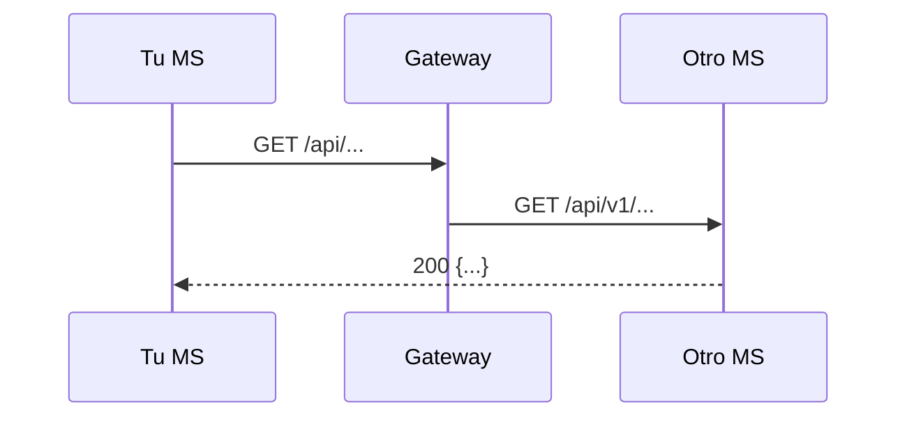

<!--
PLANTILLA — Integraciones síncronas SALIENTES (tú llamas a otro servicio por HTTP).
Preguntas guía:
  - ¿A qué servicio llamas, con qué ruta exacta y pasando por el gateway o directo?
  - ¿Con qué identidad? (token del usuario reenviado, service account propia, ninguna)
  - ¿Por qué es síncrono y no un evento? ¿Qué pasa si el otro servicio está caído (reintentos, timeout, fallback, mock)?
  - ¿Cómo lo pruebas sin el otro servicio levantado?
Si no llamas a nadie, escribe "Este servicio no hace llamadas síncronas salientes" y deja sync_calls: [] en service.yaml.
-->

# Integraciones síncronas — MSN

## Resumen
| Destino | Método y ruta | Vía | Auth | Para qué |
|---|---|---|---|---|
| | | gateway / directo | | |

## Detalle

### MSN → MSX: nombre de la integración
- **Puerto / adaptador en el código:** `src/...`
- **Ruta exacta:**
- **Autenticación:**
- **Por qué es síncrono:**
- **Si falla:** <!-- reintentos, timeout, qué estado queda, cómo se recupera -->
- **Modo sin dependencia (mock/fixture):**

