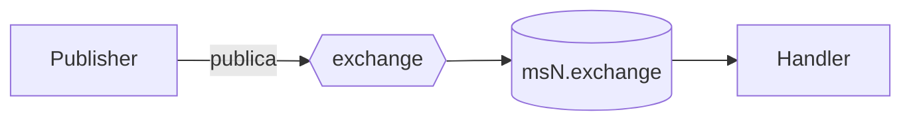

<!--
PLANTILLA — Mensajería asíncrona (RabbitMQ).
Preguntas guía:
  - ¿Qué evento disparas cuando ocurre algo importante en tu dominio? ¿Desde qué caso de uso?
  - ¿Usas outbox (el evento se guarda en la misma transacción que el cambio)?
  - ¿Qué eventos de otros servicios escuchas y qué cambia en tu servicio cuando llega cada uno?
  - ¿Cómo evitas procesar dos veces el mismo mensaje (inbox / idempotencia)?
  - ¿Hay colas declaradas para ti que NO consumes? ¿Por qué?
Los nombres de exchange, cola y contrato tienen que coincidir con contracts/events.yaml.
-->

# Mensajería — MSN

## Eventos publicados
| Exchange | Contrato (kernel) | EventType | Se dispara cuando | Outbox |
|---|---|---|---|---|
| | | | | sí / no |

## Eventos consumidos
| Cola | Exchange | Contrato | Handler | Efecto |
|---|---|---|---|---|
| | | | | |

## Colas declaradas que no se consumen
<!-- La topología crea {msN}.{exchange} para varios eventos. Lista las que ignoras y por qué. -->

## Garantías de entrega
- **Publicación:** <!-- outbox + worker / publicación directa -->
- **Consumo:** <!-- inbox por MessageId / upsert idempotente / ninguna -->
- **Reintentos:**
- **Trazabilidad:** <!-- CorrelationId, TracingConsumer, OpenTelemetry -->

## Diagrama

